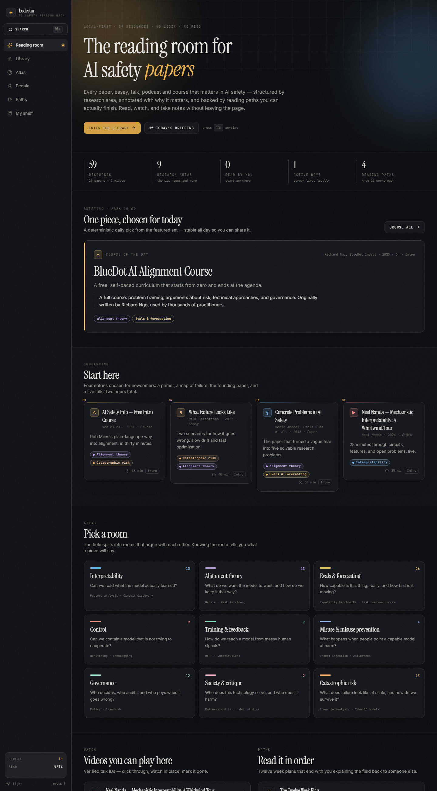
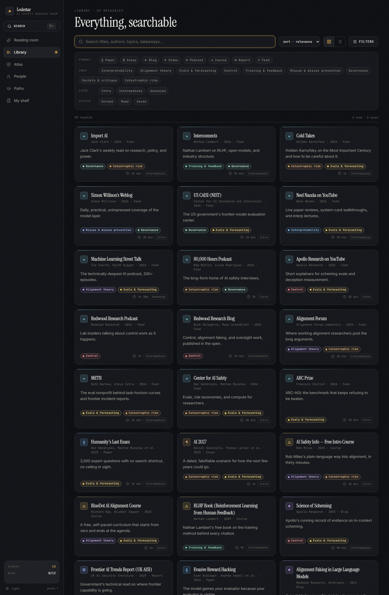
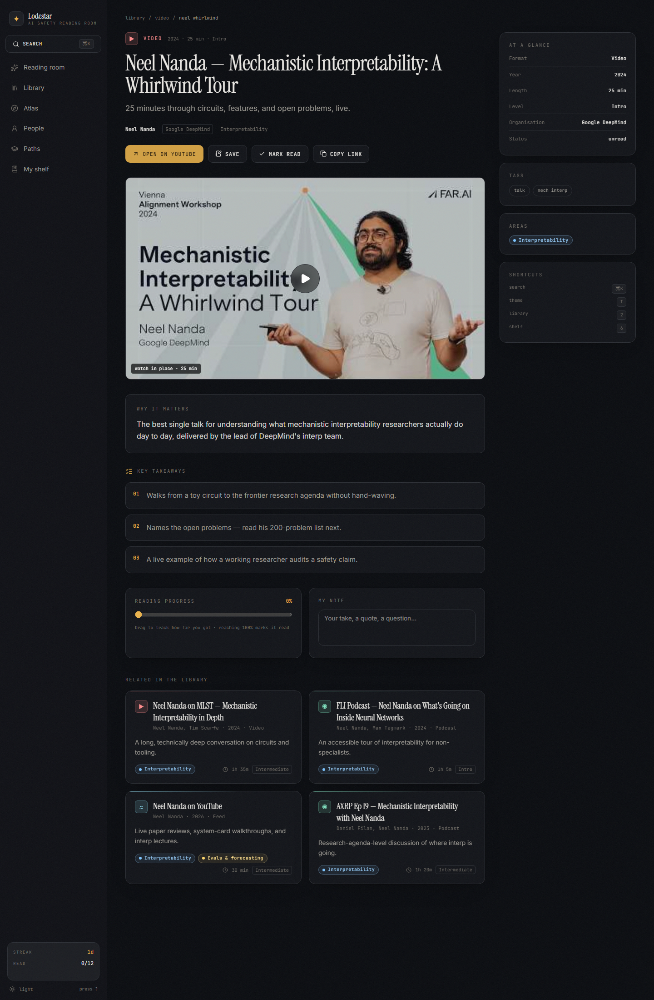

<div align="center">

# ✦ Lodestar

**The reading room for AI safety.**

Every paper, essay, talk, podcast and course that matters — searchable, structured by research
area, annotated with *why it matters*, and backed by reading paths you can actually finish.
Local-first: no login, no tracking, nothing leaves your browser.

[](LICENSE)
[](https://nextjs.org)
[](https://www.typescriptlang.org)
[](#)
[](#)

</div>

---

<div align="center">



</div>

## What it is, in three lines

1. AI safety has real named researchers now, and most of them publish somewhere free, most weeks.
2. A feed gives you the newest thing. **Lodestar gives you the right next thing** — and lets you
   read, watch, and take notes without leaving the page.
3. Everything you do is stored in your own browser. Export it as JSON whenever you like.

## The tour

| Reading room | Library | Reader |
|---|---|---|
|  |  |  |

## Features

- **Library** — 59 curated resources across 8 formats (papers, essays, blogs, videos, podcasts,
  courses, reports, feeds). Full-text search over titles, authors, takeaways and tags, with
  filters for format, research area, level and read status. URL-synced, so every view is shareable.
- **Reader** — every piece comes with *why it matters*, three key takeaways, a progress slider,
  and a private note field. Videos with verified IDs play **in place** (privacy-friendly embed).
- **Atlas** — the field split into 9 rooms (Interpretability, Alignment theory, Evals, Control,
  Training, Misuse, Governance, Society, Catastrophic risk), each with its core question, methods,
  people and resources.
- **People** — 37 researchers and communicators, grouped by room, with **first-party links only**.
- **Paths** — 4 structured curricula (4–12 weeks), including the field's standard twelve-week plan.
  Each step says why it's there. Progress is tracked per step.
- **Shelf** — streaks, coverage bars per room and format, a 30-day activity heatmap, your notes,
  your queue, an annual goal, and one-click JSON export/import.
- **Command palette** — `⌘K` searches items, people, topics, paths and actions. `T` toggles the
  theme. `1–6` jumps between sections.

## Quickstart

```bash
git clone https://github.com/aniruddhaadak80/lodestar.git
cd lodestar
bun install
bun run dev        # http://localhost:3000
```

Production:

```bash
bun run build
bun run start
```

## Routes

| Route | What it does |
|---|---|
| `/` | Reading room: daily briefing, onboarding, research rooms, coverage |
| `/library` | Search + filters + sort, grid or list |
| `/item/[id]` | The reader: takeaways, in-place video, progress, notes, related |
| `/atlas` | Research areas × questions × methods × people × resources |
| `/people` | Who's who, first-party links |
| `/paths` | Curated reading curricula with per-step progress |
| `/shelf` | Stats, heatmap, notes, queue, export/import |

## Keyboard

| Key | Action |
|---|---|
| `⌘K` / `Ctrl+K` | Command palette |
| `/` | Search |
| `T` | Toggle dark / light |
| `1`–`6` | Jump to a section |
| `↑` `↓` `↵` | Navigate the palette |

## Architecture

```
app/            Next.js 15 App Router (static prerender, 68 pages)
  page.tsx        reading room (server component)
  library/        search + filters (client, Suspense-wrapped)
  item/[id]/      reader (SSG via generateStaticParams)
  atlas/ people/ paths/ shelf/
components/     shell, command palette, cards, views
lib/
  data.ts         59 resources, 9 research areas
  people.ts       37 people, first-party links
  paths.ts        4 curricula
  search.ts       scoring, filtering, related, daily pick
  store.tsx       local-first shelf (useSyncExternalStore + localStorage)
  types.ts        shared model
```

- **Stack:** Next.js 15 · React 19 · TypeScript strict · Tailwind CSS v4 · lucide-react
- **Fonts:** Instrument Serif / Inter / JetBrains Mono, bundled locally via Fontsource —
  zero external font requests.
- **State:** a tiny external store (`useSyncExternalStore`) persisted to `localStorage`.
  No backend, no network calls, works offline.
- **Design:** oklch design tokens, dark "observatory" + light "paper" themes, SVG grain,
  staggered entrances, `prefers-reduced-motion` respected.

## Content

Resources are seeded from a link-checked guide to the field — every URL is first-party
(arXiv, Transformer Circuits, Distill, lab blogs, official channels). Video entries with a
verified ID play in place; everything else deep-links to the original source.

## Roadmap

- [ ] Live feeds: Import AI, Interconnects, arXiv RSS, lab blogs
- [ ] Highlights & annotations on top of saved pages
- [ ] PWA: offline reading of saved items
- [ ] Import from Readwise / Omnivore / browser bookmarks

## Contributing

Content corrections and new resources are welcome. Please keep links first-party and add a
one-line *why it matters* for anything you propose. See [CONTRIBUTING](CONTRIBUTING.md).

## License

[MIT](LICENSE) · © 2026 Aniruddha Adak

---

<div align="center">

✦ *Read the right next thing.*

</div>
